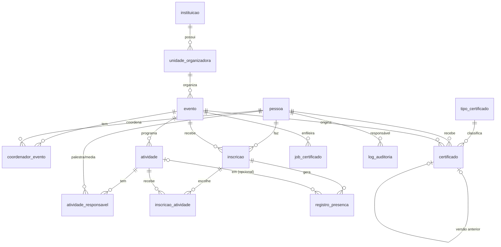

# 03 — Modelo de Dados

> Derivado das seções 7.2 e 7.3 do documento. A implementação está em `supabase/migrations/20261018000000_schema_inicial.sql`.

## Diagrama ER



## Tabelas

### `pessoa`
| Coluna | Tipo | Observação |
|---|---|---|
| id | uuid PK | |
| user_id | uuid UNIQUE NULL → `auth.users` | nulo para pessoas sem login |
| perfil | `perfil_usuario` | `participante` (padrão) / `coordenador` / `administrador` |
| nome, email | text | email único (case-insensitive) |
| cpf_cifrado | bytea NULL | RNF-007 |
| cpf_hash | text UNIQUE NULL | HMAC do CPF para deduplicação (RN 8.3) |
| matricula | text NULL | único quando informado |
| categoria | `categoria_pessoa` | discente / docente / tecnico / externo / outro |
| vinculo_institucional | text NULL | |
| consentimento_lgpd_em | timestamptz | obrigatório no cadastro (RNF-008) |
| anonimizado_em | timestamptz NULL | |

### `instituicao` / `unidade_organizadora`
`instituicao(id, nome, sigla, dados jsonb, ativo)` e `unidade_organizadora(id, instituicao_id, nome, tipo[campus|centro|curso|outro], ativo)`.

### `evento`
| Coluna | Observação |
|---|---|
| unidade_organizadora_id | a instituição é derivada da unidade |
| titulo, descricao | |
| data_inicio, data_fim | período oficial (RN 4.5) |
| inscricao_inicio, inscricao_fim | janela de inscrição (RN 9.1) |
| cancelamento_ate | prazo de cancelamento pelo participante (RN 3.2) |
| prazo_correcao_dias | padrão 30 (RN 9.3) |
| modalidade | presencial / hibrido / remoto |
| local, link, publico_alvo | |
| categorias_permitidas | `categoria_pessoa[]` — critério de elegibilidade (RN 2.2); vazio = todas |
| capacidade | NULL = ilimitado |
| lista_espera_habilitada | bool (RN 2.4) |
| frequencia_minima | % padrão 75 (RN 4.2) |
| pago | bool (fluxos financeiros — ver lacunas) |
| publicado | bool — "Salvar rascunho" × "Publicar" |
| status | `status_evento` |

### `coordenador_evento`
PK `(evento_id, pessoa_id)`. Regra de "pelo menos 1" (RN 1.2) aplicada no service **e** por trigger.

### `atividade` / `atividade_responsavel`
`atividade(id, evento_id, titulo, tipo, area_tematica, carga_horaria > 0, inicio, fim, capacidade, paralela)`.
`atividade_responsavel(atividade_id, pessoa_id, papel[palestrante|ministrante|mediador|apresentador])`.

### `inscricao` / `inscricao_atividade`
`inscricao(id, evento_id, pessoa_id, status, situacao_financeira, criada_em, motivo_status)`.
Índice único parcial: uma inscrição **ativa** por pessoa por evento (RN 2.3) — `WHERE status NOT IN ('cancelada','indeferida')`.
`inscricao_atividade(inscricao_id, atividade_id, em_espera bool)`.

### `registro_presenca`
`(id, inscricao_id, atividade_id NULL, check_in, check_out, origem[manual|leitor|avaliacao], ajuste_manual, justificativa, registrado_por)`.
`atividade_id` nulo = presença no evento como um todo. `ajuste_manual = true` exige justificativa (CHECK).

### `tipo_certificado` / `tipo_certificado_exclusividade`
Tipos semeados: participante, palestrante, ministrante, mediador, comissão organizadora, ouvinte, apresentador de trabalho. Exclusividade = par de tipos que a mesma pessoa não pode receber no mesmo evento.

### `certificado`
| Coluna | Observação |
|---|---|
| codigo | identificador único público (compartilhado entre versões) |
| versao | 1, 2, 3… — UNIQUE(codigo, versao) |
| certificado_anterior_id | aponta para a versão substituída |
| pessoa_id, evento_id, atividade_id NULL, tipo_certificado_id | |
| carga_horaria | |
| status | emitido / reemitido / substituido / cancelado |
| arquivo_path | caminho no bucket `certificados` |
| hash_arquivo | SHA-256 do PDF |
| emitido_em, emitido_por, motivo | |

### `job_certificado` (fila)
`(id, evento_id, tipo[lote|individual|reemissao], payload jsonb, status[pendente|processando|concluido|erro], tentativas, erro, criado_por, criado_em, iniciado_em, finalizado_em)`.

### `log_auditoria` (append-only)
`(id bigint identity, acao, responsavel_id, evento_id, entidade, entidade_id, justificativa, dados jsonb, criado_em)`. Trigger bloqueia UPDATE/DELETE/TRUNCATE (RNF-009).

### `solicitacao_lgpd`
`(id, pessoa_id, tipo[acesso|correcao|exclusao|anonimizacao], status, detalhes, criado_em, atendido_em, atendido_por)`.

## Máquinas de estado

### Evento
```
planejado ──► em_andamento ──► em_apuracao ──► encerrado
    │                                ▲
    └────────────────────────────────┘ (evento curto pode ir direto para apuração)
```
- Emissão de certificados só em `em_apuracao` ou `encerrado` (RN 6.5).
- Instituição/unidade com evento ≠ `encerrado` não pode ser inativada (RN 1.1).

### Inscrição
```
              ┌──────────► confirmada ──────┐
pre_inscrita ─┤                ▲            ├──► cancelada
              └──► em_espera ──┘            │
   │  │                 │                   │
   │  └─────────────────┴──► indeferida ◄───┘ (exige justificativa)
   └──────────────────────────► cancelada
```
- `cancelada` e `indeferida` são estados finais (RN 3.1).
- Ao cancelar uma inscrição confirmada, o primeiro `em_espera` é promovido (RN 3.3 — inferida).

### Certificado
```
emitido ──(reemissão)──► substituido      (nova versão nasce como "reemitido")
   │
   └──(cancelamento)───► cancelado         (não pode ser reemitido — RN 6.4)
```
Validação pública mostra: **válido** (`emitido`/`reemitido`), **corrigido** (`substituido`, com link para a versão atual) ou **cancelado**.
