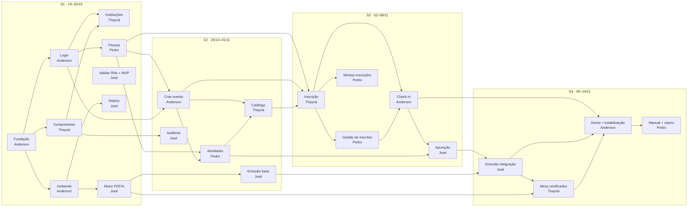

# 08 — Mapa de dependências entre cards

> Para que serve: antes de começar um card, olhe aqui **de quem você depende** e **o que precisa estar pronto**. Ao terminar um card (ou a parte que destrava alguém), avise no grupo **quem você destrava**.
> Cards e responsáveis: quadro do Trello [Gestão de eventos APP](https://trello.com/b/FplztFY4/gest%C3%A3o-de-eventos-app) e [BACKLOG.md](BACKLOG.md).

**Equipe:** Anderson · Thayná · Pedro · José — todos trabalham em todas as sprints.
**Entrega:** sábado **14/11/2026** · 4 sprints de 1 semana · code freeze **quarta 11/11**.

---

## Como ler

Cada card tem:
- **Depende de** — o que precisa existir antes, de quem é e **qual parte exata** você precisa (normalmente um endpoint ou model, não o card inteiro).
- **Destrava** — quem está esperando por você.
- ✅ = a dependência **já está pronta** na estrutura inicial (pode começar sem esperar).
- ⚠️ = dependência **dentro da mesma sprint**: a parte necessária tem prazo combinado (ver [Prazos combinados](#prazos-combinados-handoffs)).

### Regra de ouro
> **Entregue o backend (endpoint + model) cedo, mesmo sem a tela.** Quem depende de você quase sempre precisa só da API. Abra um PR pequeno com o endpoint funcionando e avise; a tela vem depois.
>
> Se a dependência ainda não estiver pronta, **combine o contrato** (formato do JSON, baseado em [05-api.md](05-api.md)) e trabalhe com dados falsos (mock) até o merge. Com sprints de uma semana, **esperar parado não é opção**.

---

## Visão geral do fluxo



---

## Prazos combinados (handoffs)

Estes prazos são o que permite várias pessoas trabalharem na mesma semana em cards que dependem um do outro. **Se for atrasar, avise no grupo no mesmo dia.**

| Quando | Quem entrega | O quê | Para quem |
|---|---|---|---|
| **Ter 20/10** | Anderson | Supabase dev criado + chaves do `.env` (canal seguro, nunca no Git) | Todos · José (Deploy, Motor) |
| **Qua 21/10** | Anderson | Trigger que cria a `pessoa` + 1 usuário de teste de cada perfil | Pedro (Pessoa) · todos |
| **Qua 21/10** | Thayná | Biblioteca de componentes instalada + componentes base | Todas as telas |
| **Qua 21/10** | José | Respostas do professor (RNs + **aprovação do MVP**) no grupo | Todos |
| **Sex 23/10** | Pedro | `GET/PUT /pessoas/me` e `GET /pessoas?busca=` | Anderson (Criar evento) · Pedro (Atividades) · Thayná (Inscrição) |
| **Ter 27/10** | Anderson | Models `Evento`/`CoordenadorEvento` + `POST /eventos` + `GET /eventos/{id}` + helper `exigir_coordenador_do_evento` | Pedro (Atividades) |
| **Qui 29/10** | Anderson | `GET /eventos` público (só publicados) | Thayná (Catálogo) |
| **Qui 29/10** | Pedro | `GET /eventos/{id}/atividades` público | Thayná (Catálogo) · José (Apuração) |
| **Ter 03/11** | Thayná | Model `Inscricao` + `StatusInscricaoService` + formato do JSON | Pedro (Gestão, Minhas) · Anderson (Check-in) |
| **Qua 04/11** | Thayná | `POST /eventos/{id}/inscricoes` no ar | Pedro · Anderson |
| **Qui 05/11** | Pedro | Ação "Confirmar inscrição" funcionando | Anderson (Check-in só aceita confirmada) |
| **Qui 05/11** | Anderson | Função de consolidação do % de presença | José (Apuração) |
| **Seg 09/11** | Anderson | Seed de demonstração (evento encerrado com presenças + evento aberto) | Todos · Pedro (roteiro) · Thayná (certificados) |
| **Ter 10/11** | José | Emissão real ligada na apuração (certificados gerados no Storage) | Thayná (Meus certificados) · Anderson (Demo) |
| **Qua 11/11** | Todos | 🧊 **Code freeze** — main com CI verde | Pedro (prints do manual) |

---

## Por sprint

### S1 — 19 a 25/10

| Card | Responsável | Depende de | Destrava |
|---|---|---|---|
| Fundação (em review) | Anderson | — | Todos |
| Ambiente da equipe | Anderson | Fundação | **Todos** · José (Deploy, Motor) — ter 20/10 |
| Login, cadastro e recuperação | Anderson | Fundação (✅ validação de token, `/auth/me`, tela de login) | Pedro (Pessoa) — qua 21/10 · todos |
| Componentes + ESLint/Prettier | Thayná | Fundação | Todas as telas — qua 21/10 |
| Instituições (T03) | Thayná | Login ⚠️ · Componentes · ✅ backend pronto | Anderson (Criar evento) — ✅ endpoints já existem |
| Pessoa e "Meu perfil" | Pedro | Login ⚠️ (trigger da `pessoa`, qua 21/10) | Anderson (Criar evento) · Pedro (Atividades) · Thayná (Inscrição) — sex 23/10 |
| Validar RNs + MVP com o professor | José | — | Todos — qua 21/10 |
| Deploy + CORS/headers | José | Ambiente ⚠️ (Supabase dev, ter 20/10) | Ambiente de demonstração |
| Motor de PDF/A | José | Ambiente ⚠️ (worker em Docker) — **use dados falsos** | José (Emissão, S2) · Thayná (Meus certificados, S4) |

### S2 — 26/10 a 01/11

| Card | Responsável | Depende de | Destrava |
|---|---|---|---|
| Criar e gerenciar evento | Anderson | Login · Pessoa · ✅ Instituições | Pedro (Atividades) — ter 27/10 · Thayná (Catálogo) — qui 29/10 · Thayná (Inscrição) · José (Apuração) |
| Catálogo + detalhe | Thayná | Criar evento ⚠️ (qui 29/10) · Atividades ⚠️ (qui 29/10) — **comece com mock** | Thayná (Inscrição) |
| Atividades | Pedro | Criar evento ⚠️ (models, ter 27/10) · Pessoa | Thayná (Catálogo) · José (Apuração) — qui 29/10 |
| Auditoria (consulta) | José | Login · Componentes · ✅ registro pronto | — |
| Emissão em lote (base) | José | Motor PDF/A · Ambiente — **elegíveis falsos** | José (integração, S4) |

### S3 — 02 a 08/11 ⚠️ semana com corrente de dependências

```
seg ─ Thayná começa Inscrição │ Pedro monta telas com mock │ Anderson monta check-in com mock │ José escreve regras da apuração com dados falsos
ter ─ Thayná entrega model Inscricao + StatusInscricaoService ──► Pedro e Anderson ligam no real
qua ─ Thayná entrega POST /inscricoes
qui ─ Pedro entrega "Confirmar" ──► Anderson │ Anderson entrega % de presença ──► José
sex ─ José liga a apuração na presença real │ todos fecham PRs
```

| Card | Responsável | Depende de | Destrava |
|---|---|---|---|
| Inscrição (T14) | Thayná | Pessoa · Criar evento · Catálogo | Pedro (Gestão, Minhas) · Anderson (Check-in) — ter 03/11 e qua 04/11 |
| Gestão de inscritos (T10) | Pedro | Inscrição ⚠️ (ter 03/11) | Anderson (Check-in) — qui 05/11 |
| Minhas inscrições (T15) | Pedro | Inscrição ⚠️ (ter 03/11) | — |
| Check-in — modo lista (T11) | Anderson | Inscrição ⚠️ · Gestão ⚠️ (até lá, confirmar no banco) | José (Apuração) — qui 05/11 |
| Apuração final (T12) | José | Check-in ⚠️ (qui 05/11) · Atividades · Criar evento | José (Emissão — integração, S4) |

### S4 — 09 a 14/11

| Card | Responsável | Depende de | Destrava |
|---|---|---|---|
| Emissão — integração | José | Apuração · Emissão (base) | Thayná (Meus certificados) · Anderson (Demo) — ter 10/11 |
| Meus certificados + validação | Thayná | Emissão ⚠️ (ter 10/11) · Motor PDF/A — **comece com certificados inseridos à mão** | Demo |
| Demo + estabilização | Anderson | Tudo das S1–S3 | Pedro (roteiro) — seed na seg 09/11 |
| Manual + roteiro | Pedro | Telas no code freeze (qua 11/11) · Demo ⚠️ | Apresentação |

---

## Visão por pessoa

### Anderson
| Sprint | Faz | Espera de | Entrega para |
|---|---|---|---|
| S1 | Fundação, Ambiente, Login | — | Todos (ter 20/10, qua 21/10) |
| S2 | Criar evento | Pedro (Pessoa, sex 23/10) | Pedro (ter 27/10) · Thayná (qui 29/10) |
| S3 | Check-in | Thayná (ter 03/11) · Pedro (qui 05/11) | José (qui 05/11) |
| S4 | Demo + estabilização | José (ter 10/11) | Todos (seg 09/11) |

### Thayná
| Sprint | Faz | Espera de | Entrega para |
|---|---|---|---|
| S1 | Componentes, Instituições | Anderson (Login) | Todos (qua 21/10) |
| S2 | Catálogo | Anderson e Pedro (qui 29/10) | — |
| S3 | Inscrição | — (tudo da S2) | Pedro e Anderson (ter 03/11, qua 04/11) |
| S4 | Meus certificados + validação | José (ter 10/11) | — |

### Pedro
| Sprint | Faz | Espera de | Entrega para |
|---|---|---|---|
| S1 | Pessoa | Anderson (qua 21/10) | Anderson, Thayná (sex 23/10) |
| S2 | Atividades | Anderson (ter 27/10) | Thayná, José (qui 29/10) |
| S3 | Gestão de inscritos, Minhas inscrições | Thayná (ter 03/11) | Anderson (qui 05/11) |
| S4 | Manual + roteiro | Code freeze (qua 11/11) · seed (seg 09/11) | Apresentação |

### José
| Sprint | Faz | Espera de | Entrega para |
|---|---|---|---|
| S1 | Validar RNs, Deploy, Motor PDF/A | Anderson (ter 20/10) | Todos (qua 21/10) |
| S2 | Auditoria, Emissão (base) | — | — |
| S3 | Apuração | Anderson (qui 05/11) · Pedro (Atividades, S2) | — |
| S4 | Emissão (integração) | — | Thayná, Anderson (ter 10/11) |

---

## Riscos de dependência

| Risco | Impacto | Plano B |
|---|---|---|
| Supabase dev atrasar (ter 20/10) | Ninguém roda o sistema completo | Cada um usa `npx supabase start` local |
| Professor não aceitar o MVP (qua 21/10) | Replanejar cortes | Trazer de volta só o que ele exigir; tirar da lista de "se atrasar, cortar" em [BACKLOG.md](BACKLOG.md) (seção Capacidade) |
| Criar evento atrasar (S2) | Atividades, Catálogo e toda a S3 | Anderson entrega os models na terça mesmo sem tela |
| Inscrição atrasar (S3) | Gestão, Check-in e Apuração na mesma semana | Combinar o JSON no domingo 01/11 e todos trabalham com mock até terça |
| Emissão de PDF falhar na S4 | Sem certificado na demo | Certificados já emitidos no seed de demonstração |
