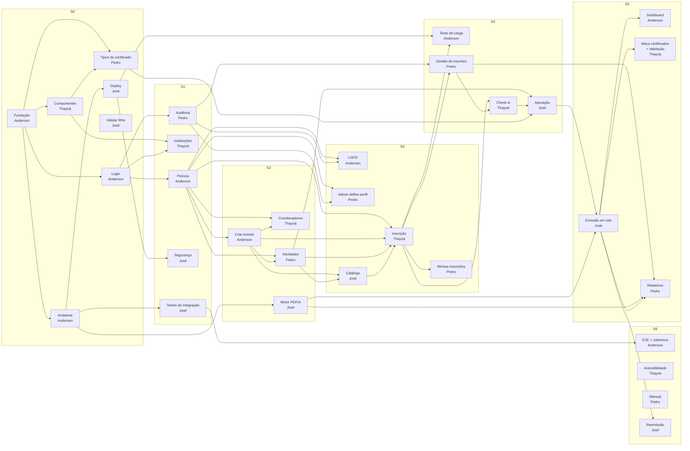

# 08 — Mapa de dependências entre cards

> Para que serve: antes de começar um card, olhe aqui **de quem você depende** e **o que precisa estar pronto**. Ao terminar um card (ou a parte que destrava alguém), avise no grupo **quem você destrava**.
> Cards e responsáveis: quadro do Trello [Gestão de eventos APP](https://trello.com/b/FplztFY4/gest%C3%A3o-de-eventos-app) e [BACKLOG.md](BACKLOG.md).

**Equipe:** Anderson · Thayná · Pedro · José — todos trabalham em todas as sprints.

---

## Como ler

Cada card tem:
- **Depende de** — o que precisa existir antes, de quem é e **qual parte exata** você precisa (normalmente um endpoint ou model, não o card inteiro).
- **Destrava** — quem está esperando por você.
- ✅ = a dependência **já está pronta** na estrutura inicial (pode começar sem esperar).
- ⚠️ = dependência **dentro da mesma sprint**: a parte necessária tem prazo combinado (ver [Prazos combinados](#prazos-combinados-handoffs)).

### Regra de ouro
> **Entregue o backend (endpoint + model) cedo, mesmo sem a tela.** Quem depende de você quase sempre precisa só da API. Abra um PR pequeno com o endpoint funcionando e avise; a tela vem depois.
>
> Se a dependência ainda não estiver pronta, **combine o contrato** (formato do JSON, baseado em [05-api.md](05-api.md)) e trabalhe com dados falsos (mock) até o merge.

---

## Visão geral do fluxo

**Caminho crítico (se atrasar, o MVP atrasa):**
`Login (Anderson) → Pessoa (Anderson) → Criar evento (Anderson) → Atividades (Pedro) → Catálogo (José) → Inscrição (Thayná) → Gestão de inscritos (Pedro) → Check-in (Thayná) → Apuração (José) → Emissão em lote (José) → Meus certificados + Validação (Thayná)`

---

## Sprint 0 — Fundação

| Card | Responsável | Depende de | Destrava |
|---|---|---|---|
| Fundação do projeto | Anderson | — | todos |
| Ambiente da equipe | Anderson | Fundação ✅ | **todos** · José (Deploy, Testes de integração, Motor PDF/A) |
| Login, cadastro e recuperação de senha | Anderson | Fundação ✅ | Anderson (Pessoa) · Thayná (Instituições) · Pedro (Auditoria) |
| Componentes acessíveis | Thayná | Fundação ✅ | **todas as telas** · Pedro (Tipos, mesma sprint) · Thayná (Instituições) |
| Tipos de certificado (T04) | Pedro | Fundação ✅ · Componentes (**Thayná** ⚠️) | José (Apuração, S4) |
| Validar RNs com o professor | José | — | todos os cards com regra de negócio |
| Deploy de homologação | José | Ambiente (**Anderson** ⚠️) | José (Segurança) · Anderson (Teste de carga) |

**O que cada um precisa receber nesta sprint:**
- **Todos ← Anderson:** projeto Supabase dev + chaves do `.env` — **primeiros dias da S0**. Sem isso ninguém roda o sistema completo.
- **Pedro ← Thayná:** componentes base (botão, campo com erro, tabela, modal, toast). Enquanto isso, Pedro faz o **backend** dos Tipos (tabela e seed já existem ✅).
- **José ← Anderson:** Supabase dev criado para configurar as variáveis do deploy.
- ✅ Já prontos para todos: `get_usuario_atual`, `require_perfil` (`AdminDep`/`CoordenadorDep`), `GET /auth/me`, tela de login e rotas protegidas.

---

## Sprint 1 — Cadastros base

| Card | Responsável | Depende de | Destrava |
|---|---|---|---|
| Cadastro de pessoa e Meu perfil | Anderson | Login (Anderson) | Anderson (Criar evento, LGPD) · Thayná (Coordenadores, Inscrição) · Pedro (Atividades, Admin define perfil) |
| Tela de Instituições (T03) | Thayná | Login (Anderson) · Componentes (Thayná) | Anderson (Criar evento — ✅ endpoints já existem, não precisa esperar a tela) |
| Auditoria: consulta e exportação (T05) | Pedro | Login (Anderson) | Anderson (LGPD) · Pedro (Admin define perfil, Gestão de inscritos) |
| Segurança: rate limit, headers, backup | José | Deploy (José) | todos os endpoints novos (já nascem protegidos) |
| Testes de integração contra Postgres real | José | Ambiente (Anderson) | **todos** (testes de integração nos próprios cards) · Anderson (Carga, E2E) |

**O que cada um precisa receber:**
- **Thayná e Pedro ← Anderson (fim da S1):** `GET /pessoas?busca=` e `POST /pessoas/externas` — usados na S2 para escolher coordenador e palestrante.
- **Thayná ← Anderson (fim da S1):** `GET/PUT /pessoas/me` com categoria — usado no passo 1 da inscrição (S3).
- **Todos ← José (fim da S1):** fixture de testes de integração + exemplo com Instituições.
- ✅ `AuditoriaService.registrar()` **já existe** — todo mundo já pode registrar ações de impacto; o card do Pedro entrega só consulta, exportação e tela.

---

## Sprint 2 — Evento

| Card | Responsável | Depende de | Destrava |
|---|---|---|---|
| Criar e gerenciar evento (T07) | Anderson | Login · Pessoa (Anderson) · Instituições (✅ endpoints) | Thayná (Coordenadores ⚠️, Inscrição) · Pedro (Atividades ⚠️) · José (Catálogo, Apuração) · Anderson (Dashboard) |
| Coordenadores do evento (T08) | Thayná | Criar evento (**Anderson** ⚠️) · Pessoa (**Anderson**) | — |
| Programação / Atividades (T09) | Pedro | Criar evento (**Anderson** ⚠️) · Pessoa (**Anderson**) | José (Catálogo, Apuração) · Thayná (Inscrição) |
| Motor de PDF/A | José | Ambiente (**Anderson**) — usa dados falsos, **não depende da apuração** | José (Emissão em lote) · Pedro (Relatórios em PDF) |

**O que cada um precisa receber:**
- **Thayná e Pedro ← Anderson (primeiros dias da S2):** models `Evento` e `CoordenadorEvento`, `POST /eventos`, `GET /eventos/{id}` e o helper `exigir_coordenador_do_evento`. Até lá: tela com mock e testes de regra (o banco já bloqueia remover o último coordenador ✅).
- **José ← Pedro (fim da S2):** `GET /eventos/{id}/atividades` + detecção de atividades paralelas — usados no Catálogo (S3) e na Apuração (S4).
- **José ← Anderson (fim da S2):** status "publicado" + `GET /eventos` público — usados no Catálogo.

---

## Sprint 3 — Inscrição

| Card | Responsável | Depende de | Destrava |
|---|---|---|---|
| Privacidade LGPD | Anderson | Pessoa (Anderson) · Auditoria (**Pedro**, S1) | — |
| Tela de inscrição (T14) | Thayná | Pessoa · Criar evento (**Anderson**) · Atividades (**Pedro**) · Catálogo (**José** ⚠️) | Pedro (Minhas inscrições ⚠️, Gestão de inscritos) · Thayná (Check-in) · Anderson (Teste de carga, Dashboard) |
| Minhas inscrições e cancelamento (T15) | Pedro | Inscrição (**Thayná** ⚠️) | — |
| Admin define o perfil do usuário | Pedro | Pessoa (**Anderson**) · Auditoria (Pedro) | facilita os testes de todos |
| Catálogo de eventos (T13) | José | Criar evento (**Anderson**) · Atividades (**Pedro**) | Thayná (Inscrição — botão "Inscrever-se") |

**O que cada um precisa receber:**
- **Pedro ← Thayná (primeiros dias da S3):** model `Inscricao` + formato do JSON de inscrição. Pedro faz a lista e o cancelamento em cima disso.
- **Thayná ← José (primeiros dias da S3):** rota `/eventos/:id` com o botão "Inscrever-se" levando para `/eventos/:id/inscricao`. Até lá, Thayná acessa o formulário direto pela URL.
- **Pedro e Anderson ← Thayná (fim da S3):** `StatusInscricaoService` + endpoint de inscrição com trava de concorrência — Pedro usa na Gestão (S4), Anderson no Teste de carga (S4).

---

## Sprint 4 — Gestão, presença e apuração

| Card | Responsável | Depende de | Destrava |
|---|---|---|---|
| Teste de carga (500 usuários) | Anderson | Inscrição (**Thayná**, S3) · Deploy (**José**) | — |
| Check-in e presença (T11) | Thayná | Inscrição (Thayná) · Gestão de inscritos (**Pedro** ⚠️) | José (Apuração ⚠️) |
| Gestão de inscritos (T10) | Pedro | Inscrição (**Thayná**, S3) · Auditoria (Pedro) | Thayná (Check-in ⚠️) · Pedro (Relatórios) |
| Apuração final (T12) | José | Check-in (**Thayná** ⚠️) · Tipos (**Pedro**) · Atividades (**Pedro**) · Criar evento (**Anderson**) | José (Emissão em lote) |

**O que cada um precisa receber:**
- **Thayná ← Pedro (primeiros dias da S4):** ação **"Confirmar inscrição"** — check-in só aceita inscrição confirmada. Até lá, Thayná confirma inscrições direto no banco para testar.
- **José ← Thayná (meio da S4):** tabela `registro_presenca` preenchida + função de **consolidação do % de presença** por pessoa e por atividade. Até lá, José escreve o service de elegibilidade e os testes com dados falsos (é lógica pura).

---

## Sprint 5 — Certificados (MVP)

| Card | Responsável | Depende de | Destrava |
|---|---|---|---|
| Dashboard por perfil (T02) | Anderson | Criar evento (Anderson) · Inscrição (**Thayná**) · Emissão em lote (**José** ⚠️) | — |
| Meus certificados + Validação pública (T16, T17) | Thayná | Emissão em lote (**José** ⚠️) · Motor de PDF/A (**José**) | — (fecha o MVP) |
| Relatórios oficiais (T06) | Pedro | Gestão de inscritos (Pedro) · Emissão em lote (**José** ⚠️) · Motor de PDF/A (**José**) | — |
| Emissão em lote: fila, Storage e progresso | José | Apuração (José) · Motor de PDF/A (José) · Ambiente (**Anderson**) | Thayná (Meus certificados ⚠️) · Pedro (Relatórios ⚠️) · Anderson (Dashboard ⚠️) · José (Reemissão) |

**O que cada um precisa receber:**
- **Thayná, Pedro e Anderson ← José (primeiros dias da S5):** registros na tabela `certificado` + PDF no Storage. Até lá:
  - **Thayná** faz as telas com certificados inseridos direto no banco
  - **Pedro** começa pelo relatório de **indeferimentos** (não depende de certificados)
  - **Anderson** começa pelos indicadores de eventos e inscrições

---

## Sprint 6 — Fechamento

| Card | Responsável | Depende de | Destrava |
|---|---|---|---|
| E2E + cobertura mínima de 70% | Anderson | MVP completo (todos) · Testes de integração (**José**, S1) | — |
| Acessibilidade e usabilidade | Thayná | Telas principais (todos) | — |
| Manual do usuário e apresentação | Pedro | MVP completo (todos) | — |
| Reemissão e cancelamento de certificado | José | Emissão em lote (José) · Motor de PDF/A (José) | — |

---

## Visão por pessoa

### Anderson
| Sprint | Card | Espera por | Quem espera por ele |
|---|---|---|---|
| S0 | Fundação · Ambiente · Login | — | **todos** (Supabase dev) · José (Deploy, Testes, Motor) · Thayná (Instituições) · Pedro (Auditoria) |
| S1 | Cadastro de pessoa | — | **Thayná** (Coordenadores, Inscrição) · **Pedro** (Atividades, Admin define perfil) |
| S2 | Criar evento | Thayná (Instituições — ✅ endpoints prontos) | **Thayná** (Coordenadores) · **Pedro** (Atividades) · **José** (Catálogo, Apuração) |
| S3 | Privacidade LGPD | **Pedro** (Auditoria, S1) | — |
| S4 | Teste de carga | **Thayná** (Inscrição) · **José** (Deploy) | — |
| S5 | Dashboard | **José** (Emissão em lote) | — |
| S6 | E2E + cobertura | **José** (Testes de integração) · todos (MVP) | — |

### Thayná
| Sprint | Card | Espera por | Quem espera por ela |
|---|---|---|---|
| S0 | Componentes | — | **todos** (telas) · **Pedro** (Tipos) |
| S1 | Instituições | **Anderson** (Login) | — |
| S2 | Coordenadores | **Anderson** (Criar evento, Pessoa) | — |
| S3 | Inscrição | **Anderson** (Pessoa, Evento) · **Pedro** (Atividades) · **José** (Catálogo) | **Pedro** (Minhas inscrições, Gestão) · **Anderson** (Carga, Dashboard) |
| S4 | Check-in | **Pedro** (Gestão — "Confirmar") | **José** (Apuração) |
| S5 | Meus certificados + Validação | **José** (Emissão em lote) | — |
| S6 | Acessibilidade | todos (telas) | — |

### Pedro
| Sprint | Card | Espera por | Quem espera por ele |
|---|---|---|---|
| S0 | Tipos de certificado | **Thayná** (Componentes, só para a tela) | **José** (Apuração) |
| S1 | Auditoria | **Anderson** (Login ✅) | **Anderson** (LGPD) |
| S2 | Atividades | **Anderson** (Criar evento, Pessoa) | **José** (Catálogo, Apuração) · **Thayná** (Inscrição) |
| S3 | Minhas inscrições · Admin define perfil | **Thayná** (Inscrição) · **Anderson** (Pessoa) | — |
| S4 | Gestão de inscritos | **Thayná** (Inscrição) | **Thayná** (Check-in) |
| S5 | Relatórios | **José** (Emissão em lote, Motor PDF/A) | — |
| S6 | Manual e apresentação | todos (MVP) | — |

### José
| Sprint | Card | Espera por | Quem espera por ele |
|---|---|---|---|
| S0 | Validar RNs · Deploy | **Anderson** (Ambiente) | todos (RNs) · **Anderson** (Carga) |
| S1 | Segurança · Testes de integração | **Anderson** (Ambiente) | **todos** (fixture de testes) · **Anderson** (E2E) |
| S2 | Motor de PDF/A | **Anderson** (Ambiente) | **Pedro** (Relatórios em PDF) |
| S3 | Catálogo | **Anderson** (Criar evento) · **Pedro** (Atividades) | **Thayná** (Inscrição) |
| S4 | Apuração final | **Thayná** (Check-in) · **Pedro** (Tipos, Atividades) · **Anderson** (Criar evento) | — |
| S5 | Emissão em lote | — (cadeia própria) | **Thayná** (Meus certificados) · **Pedro** (Relatórios) · **Anderson** (Dashboard) |
| S6 | Reemissão | — | — |

---

## Prazos combinados (handoffs)

Entregas pequenas que **destravam outra pessoa** e por isso têm prazo próprio, antes do fim do card:

| Até | Quem entrega | O quê | Para quem |
|---|---|---|---|
| Início da S0 | Anderson | Supabase dev + chaves do `.env` | todos |
| Início da S0 | Thayná | Componentes base do frontend | todos (primeiro: Pedro, tela de Tipos) |
| Fim da S0 | Anderson | Trigger que cria a `pessoa` no cadastro + forma fácil de logar com cada perfil | todos |
| Fim da S1 | Anderson | `GET /pessoas?busca=` e `POST /pessoas/externas` | Thayná, Pedro |
| Fim da S1 | Anderson | `GET/PUT /pessoas/me` | Thayná |
| Fim da S1 | José | Fixture de testes de integração + exemplo | todos |
| Início da S2 | Anderson | models `Evento`/`CoordenadorEvento` + `POST`/`GET /eventos` + `exigir_coordenador_do_evento` | Thayná, Pedro |
| Fim da S2 | Pedro | `GET /eventos/{id}/atividades` + detecção de paralelas | José, Thayná |
| Fim da S2 | Anderson | status "publicado" + `GET /eventos` público | José |
| Fim da S2 | José | Motor de PDF/A gerando PDF de exemplo | Pedro (Relatórios), José (Emissão) |
| Início da S3 | Thayná | model `Inscricao` + formato do JSON | Pedro |
| Início da S3 | José | rota `/eventos/:id` com botão "Inscrever-se" | Thayná |
| Fim da S3 | Thayná | `StatusInscricaoService` + inscrição com trava de concorrência | Pedro, Anderson |
| Início da S4 | Pedro | ação "Confirmar inscrição" | Thayná |
| Meio da S4 | Thayná | consolidação do % de presença | José |
| Início da S5 | José | certificados gravados + PDF no Storage | Thayná, Pedro, Anderson |

> Atrasou um handoff? Avise no grupo **no mesmo dia** — quem depende pode adiantar a tela com mock ou trocar a ordem das tarefas.
