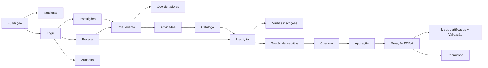

# Backlog — Sistema de Gestão de Eventos Institucionais

> Espelho do quadro do Trello **[Gestão de eventos APP](https://trello.com/b/FplztFY4/gest%C3%A3o-de-eventos-app)**.
> Cada card é uma **funcionalidade completa** (backend + tela + testes). As tarefas técnicas ficam no checklist **"Tarefas"** dentro do card no Trello; aqui fica a visão geral.
> Fonte de verdade do andamento: **o Trello**. Este arquivo é atualizado quando o plano muda.

## Como ler

- **Tipo:** `[Feature]` funcionalidade · `[Infra]` ambiente/deploy · `[Qualidade]` testes/segurança · `[Doc]` documentação
- **Prioridade** (herdada do PDF): **E** = Essencial · **I** = Importante · **D** = Desejável
- **Pts** — estimativa relativa (1 pt ≈ meio dia de uma pessoa)
- **Branch:** `feat/<nome-curto-do-card>` (ex.: `feat/criar-evento`). Cite o nome do card no PR.

### Definição de Pronto (DoD)
1. Todos os itens do checklist "Tarefas" e os critérios de aceite do card concluídos.
2. Código revisado por pelo menos 1 colega (PR) e CI verde (lint + testes + build).
3. Testes automatizados das regras de negócio do card.
4. Ações de impacto gravam `log_auditoria` com responsável e justificativa.
5. Tela navegável por teclado, com `label` em todos os campos e responsiva.
6. Endpoints aparecem corretamente no `/docs` (OpenAPI).

---

## Equipe e divisão

O trabalho é dividido entre **4 pessoas fullstack**, por fatia vertical (cada um faz backend + tela da própria funcionalidade). Meta: ~1/4 dos ~275 pts restantes por pessoa (≈ 69 pts).

| Pessoa | Foco | Cards |
|---|---|---|
| **Anderson** | Supabase/infra + base do sistema (conta → pessoa → evento) + LGPD | 7 cards · ~66 pts restantes |
| Pessoa 2 | _a definir_ | — |
| Pessoa 3 | _a definir_ | — |
| Pessoa 4 | _a definir_ | — |

> Sugestão para os outros três (pts restantes, sem contar os cards de qualidade):
> - **Pessoa 2 — Inscrição e presença (~59):** Catálogo (T13), Inscrição (T14), Minhas inscrições (T15), Check-in (T11)
> - **Pessoa 3 — Admin e programação (~59):** Componentes acessíveis, Instituições (T03, falta a tela), Tipos de certificado (T04), Auditoria (T05, falta consulta e tela), Coordenadores (T08), Programação/Atividades (T09), Gestão de inscritos (T10)
> - **Pessoa 4 — Certificados e fechamento (~70):** Validar RNs com o professor, Deploy, Apuração (T12), Geração PDF/A, Meus certificados + Validação (T16/T17), Reemissão, Relatórios (T06), Dashboard (T02)
> - **Todos na S6 (~25, dividir entre os 4):** Segurança, Testes de integração/carga/E2E, Acessibilidade, Manual e apresentação — quem estiver mais leve pega mais

---

## Plano de sprints (7 sprints de 2 semanas)

**Marco do MVP (fim da S5):** criar evento → inscrever → check-in → emitir certificado → validar publicamente.

| Sprint | Objetivo | Pts |
|---|---|---|
| **S0** | Fundação, ambiente e login funcionando ponta a ponta | ~50 |
| **S1** | Cadastros base: instituições, pessoa, tipos de certificado, auditoria, perfis, deploy | ~55 |
| **S2** | Coordenador consegue montar um evento completo | ~45 |
| **S3** | Participante encontra o evento e se inscreve | ~36 |
| **S4** | Gestão de inscritos e check-in | ~35 |
| **S5** | Certificados: apuração, PDF/A e validação pública (**MVP**) | ~37 |
| **S6** | Reemissão, relatórios, dashboard, LGPD, qualidade e entrega | ~58 |
| | **Total** | **~316** |

---

## Cards

### S0 — Fundação

| Card | Tipo | Pri | Pts | Responsável | Depende de |
|---|---|---|---|---|---|
| Fundação do projeto (estrutura, CI, schema do banco) — **Em review**, quase tudo pronto | Infra | E | 18 | Anderson | — |
| Ambiente da equipe: Supabase compartilhado, local e worker em Docker | Infra | E | 7 | Anderson | Fundação |
| Biblioteca de componentes acessível + ESLint/Prettier | Infra | I | 5 | — | Fundação |
| Validar regras de negócio e lacunas com o professor | Doc | E | 1 | — | — |
| Login, cadastro de conta e recuperação de senha (T01) — parte pronta | Feature | E | 19 | Anderson | Fundação |

### S1 — Cadastros base

| Card | Tipo | Pri | Pts | Responsável | Depende de |
|---|---|---|---|---|---|
| Tela de Instituições e Unidades (T03) — backend pronto | Feature | E | 13 | — | Login |
| Cadastro de pessoa e "Meu perfil" com consentimento LGPD | Feature | E | 15 | Anderson | Login |
| Tela de Tipos de certificado (T04) | Feature | I | 6 | — | Fundação |
| Auditoria: consulta e exportação dos logs (T05) — registro pronto | Feature | I | 13 | — | Login |
| Admin define o perfil do usuário (coordenador/administrador) | Feature | I | 3 | Anderson | Cadastro de pessoa |
| Deploy de homologação (API, frontend e worker) | Infra | I | 5 | — | Ambiente |

### S2 — Evento

| Card | Tipo | Pri | Pts | Responsável | Depende de |
|---|---|---|---|---|---|
| Criar e gerenciar evento (T07) | Feature | E | 23 | Anderson | Instituições, Login |
| Coordenadores do evento (T08) | Feature | E | 6 | — | Criar evento, Pessoa |
| Programação / Atividades do evento (T09) | Feature | E | 16 | — | Criar evento, Pessoa |

### S3 — Inscrição

| Card | Tipo | Pri | Pts | Responsável | Depende de |
|---|---|---|---|---|---|
| Catálogo de eventos e página de detalhe (T13) | Feature | E | 8 | — | Criar evento, Atividades |
| Tela de inscrição do participante (T14) | Feature | E | 22 | — | Pessoa, Evento, Atividades, Catálogo |
| Minhas inscrições e cancelamento pelo participante (T15) | Feature | E | 6 | — | Inscrição |

### S4 — Gestão e presença

| Card | Tipo | Pri | Pts | Responsável | Depende de |
|---|---|---|---|---|---|
| Gestão de inscritos: confirmar, indeferir e cancelar (T10) | Feature | E | 12 | — | Inscrição, Auditoria |
| Check-in e presença: modo lista e leitor de QR Code (T11) | Feature | E | 23 | — | Inscrição, Gestão de inscritos |

### S5 — Certificados (MVP)

| Card | Tipo | Pri | Pts | Responsável | Depende de |
|---|---|---|---|---|---|
| Apuração final: cálculo de quem tem direito a certificado (T12) | Feature | E | 15 | — | Check-in, Tipos de certificado |
| Geração dos certificados em PDF/A com QR Code (fila + worker) | Feature | E | 16 | — | Apuração, Ambiente |
| Meus certificados e validação pública por QR Code (T16, T17) | Feature | E | 6 | — | Geração dos certificados |

### S6 — Fechamento

| Card | Tipo | Pri | Pts | Responsável | Depende de |
|---|---|---|---|---|---|
| Reemissão e cancelamento de certificado | Feature | E | 8 | — | Geração dos certificados |
| Relatórios oficiais do evento (T06) | Feature | D | 11 | — | Certificados, Gestão de inscritos |
| Dashboard por perfil (T02) | Feature | I | 8 | — | Funcionalidades principais |
| Privacidade LGPD: solicitações do titular e anonimização | Feature | E | 6 | Anderson | Pessoa, Auditoria |
| Segurança: rate limit, headers e backup/restauração | Qualidade | E | 4 | — | Deploy |
| Testes de integração, carga (500 usuários) e E2E | Qualidade | I | 13 | — | MVP |
| Acessibilidade (WCAG AA) e teste de usabilidade | Qualidade | I | 5 | — | Telas principais |
| Manual do usuário e roteiro de apresentação | Doc | I | 3 | — | MVP |

---

## ⚠️ Capacidade

Já estão prontos ~41 pts (estrutura inicial), restando **~275 pts**. Com 4 pessoas em 7 sprints, isso dá **~10 pts por pessoa por sprint** (≈ 5 dias de trabalho a cada 2 semanas) — o plano ocupa as sprints inteiras, sem folga. Se o ritmo real ficar abaixo disso, cortar nesta ordem:

1. **Relatórios (T06)** — RF-012 está "em negociação" e é Desejável no PDF
2. Itens "(Desejável)" dentro dos checklists (emissão automática, situação financeira)
3. Dashboard simplificado (só atalhos, sem indicadores)
4. Teste de carga reduzido (100 usuários em vez de 500)

## Dependências críticas

O caminho **Login → Pessoa → Evento** (Anderson) trava o resto do fluxo: vale priorizar esses cards e publicar os endpoints cedo (mesmo antes da tela), para quem pega Atividades, Catálogo e Inscrição poder integrar.
